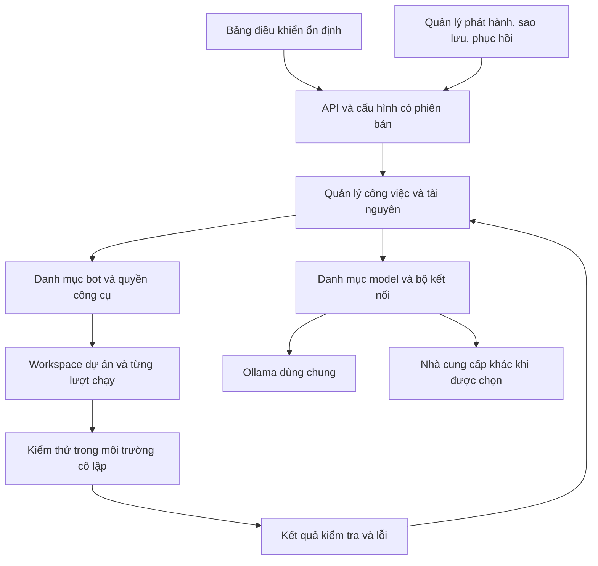

# Nền tảng bot: hiện trạng, quy ước và lộ trình

Cập nhật: 20/10/2026, bản `0.2.0-dev`. Mốc ban đầu: `879ace0cb7cd0c7524e1aae0e9da265deda5b364` (`0.1.0-dev`). Hướng dẫn phần đã triển khai: [CAP_NHAT_0_2.md](CAP_NHAT_0_2.md).

Tài liệu này là bản đối chiếu khi thêm bot, đổi model hoặc phát hành. Các mục ghi **cần xây** là thiết kế dự kiến, chưa phải chức năng đang chạy. Cập nhật trạng thái và bằng chứng sau mỗi lần triển khai; không đánh dấu hoàn thành chỉ vì đã có giao diện hoặc lời nhắc.

## 1. Mục tiêu chung

Giữ một bảng điều khiển ổn định cho Trao đổi, Công việc, Đội bot, Tài liệu, Tài nguyên và Thiết lập. Bot, model và phiên bản ứng dụng có thể thay đổi bên dưới qua cấu hình có phiên bản. Thêm model lớn không mặc nhiên yêu cầu đổi giao diện.

Mỗi công việc phải biết nó thuộc dự án nào, dùng bot/model/cấu hình nào, đã kiểm tra gì và để lại tệp ở đâu. Cập nhật thất bại phải giữ được dữ liệu và có đường quay lại phiên bản đã kiểm chứng.

Không thể bảo đảm mọi bot/model bên ngoài tương thích ngay hoặc mọi máy dùng cùng thiết lập tối ưu. Chỉ công bố hỗ trợ sau khi khai báo khả năng và chạy bộ kiểm chứng phù hợp trên môi trường đích.

## 2. Đã có và còn thiếu

| Phần | Đã có trong mã | Cần xây hoặc xác nhận |
| --- | --- | --- |
| Bảng điều khiển | Giữ các khu cũ; thêm thiết lập dự án/model và xem cấu hình/kiểm thử; API/schema v1; assets no-store | Nâng cấp dữ liệu thật trên Windows, quản lý tương thích nhiều phiên bản API |
| Đội bot | 1 quản lý, 5 chuyên gia, 3 vai trò; hash phiên bản hướng dẫn, phân công model và snapshot | Đăng ký bot mới không cần sửa mã, bộ công cụ tùy vai trò |
| ECC | Xác minh hash, nạp bản tham khảo đầy đủ của chuyên gia đã chọn, giữ snapshot; 6 lệnh ứng dụng có bộ xử lý | Chưa hỗ trợ toàn bộ agent/skill/lệnh, hook hoặc runtime ECC |
| Model | Hồ sơ/revision; chọn theo vai trò và nhà cung cấp; giới hạn đầu vào/đầu ra/thời hạn gọi; giữ cấu hình theo lượt | Kiểm tra năng lực và đo chất lượng trên máy đích; chưa có tự chọn/dự phòng model |
| Workspace | Dự án/bộ nhớ riêng, lọc nhiệm vụ, workspace logic theo vai trò và báo cáo trong SQLite | Workspace thư mục bền vững và vùng ghi riêng khi bot có công cụ |
| Tài nguyên | 1 nhiệm vụ chạy, tối đa 10 chờ; mặc định 20 lượt gọi; quan sát CPU/RAM và NVIDIA khi có | Ngân sách context/token, ổ đĩa, thời gian toàn lượt, lịch nạp model và kiểm soát tài nguyên thực thi |
| Chất lượng | Runner unittest Python trong Docker tùy chọn, lỗi đưa vào vòng sửa; giữ kiểm tra tĩnh và hạn mức | Runner web, test độc lập từ yêu cầu, đánh giá Ollama thật |
| Bảo trì dữ liệu | Gói mã/SQLite trước cập nhật; kiểm hash và phục hồi sang thư mục mới; chặn schema quá mới | Phục hồi và dọn backup tự động theo dung lượng |
| Cập nhật | Thử import/đồ thị/migration trên bản sao trước fast-forward; dependency đổi cài môi trường riêng; khóa app/updater | Tự chuyển lại phiên bản, kiểm thử nâng cấp toàn bộ trên Windows |
| Kiểm chứng | Có unittest, kiểm thử Chromium và cấu hình CI Windows/Ubuntu | Xác nhận CI từ xa, đánh giá Ollama thật, kiểm tra nâng cấp/khôi phục trên Windows |

Các kiểm thử dùng LangGraph thật/provider giả lập cho luồng ứng dụng, Chromium cho giao diện và Docker Linux thật cho runner. Không phải bằng chứng toàn bộ ECC hoặc Ollama thật đã đạt. Xem ghi chú phát hành cho số kiểm thử; sản phẩm Python người dùng gửi trước đó vẫn cần sửa lỗi của chính sản phẩm.

Nguồn đối chiếu: `expert_team.py`, `workspace_data.py`, `app.py`, `file_generation.py`, `artifacts.py`, `resource_monitor.py`, `maintenance.py`, `update_app.py`, `runtime_version.py`, `EVALUATION.md` và `.github/workflows/tests.yml`.

## 3. Kiến trúc đích — đã triển khai một phần theo bảng hiện trạng



### Quy ước bot

Mỗi bot cần có ID ổn định, phiên bản hướng dẫn, nguồn/giấy phép/hash nếu lấy từ ECC, loại nhiệm vụ nhận được, kiểu đầu vào/đầu ra, danh sách công cụ được cấp, model phù hợp, ngân sách và tiêu chí kiểm chứng. Trạng thái gồm chưa hỗ trợ, đang thử, đã kiểm chứng hoặc bị vô hiệu hóa.

Một bot hoạt động phải có đường đi từ yêu cầu → công cụ thực tế → kết quả → kiểm tra. Tên gọi, icon hoặc một tệp Markdown riêng chưa đủ để xác nhận bot hoạt động.

Các lệnh có bộ đăng ký riêng: tên lệnh, phiên bản, tham số được phép, bot/bước nhận việc và loại bằng chứng phải trả về. Lệnh chưa nối vào mã phải báo chưa hỗ trợ. Hướng dẫn nguồn được rà soát và chuyển đổi phù hợp; hook hoặc lệnh shell trong kho ngoài không tự chạy khi nhập bot.

### Quy ước model

Một hồ sơ model gồm nhà cung cấp, tên/định danh model, phiên bản hoặc digest nếu lấy được, địa chỉ dịch vụ, giới hạn context/đầu ra, tham số sinh, thời hạn gọi và khả năng đã kiểm chứng: streaming, hủy, structured output, tool calling. Khả năng không được suy từ tên model; cần thử nhỏ và lưu kết quả. Khóa API chỉ được tham chiếu qua nơi lưu bí mật, không chép vào tài liệu hoặc bản sao cấu hình.

Bot chọn model qua hồ sơ này. Đầu tiên giữ 1 lượt suy luận tại một thời điểm trên máy hiện tại; nhiều vai trò có thể dùng chung model. Model lớn chỉ nạp khi có nhu cầu và đủ tài nguyên. Chưa biết RAM/VRAM máy thì chưa đặt ngưỡng phần cứng hoặc tự tải thêm model.

Không tự đổi nhà cung cấp, gửi dữ liệu sang dịch vụ khác hoặc dùng API trả phí khi hồ sơ hiện tại lỗi. Dự phòng chỉ chạy với cấu hình đã được người dùng cho phép.

### Quy ước workspace

Tách mã ứng dụng, tài nguyên model dùng chung, dữ liệu dự án và dữ liệu từng lượt chạy. Không tạo một bản sao model hoặc môi trường Python cho mỗi tên bot.

Cấu trúc đích, chưa áp dụng cho SQLite hiện tại:

```text
data/projects/<project_id>/
  documents/                  tài liệu thuộc dự án
  runs/<run_id>/
    run.json                  bản chụp cấu hình và phiên bản
    input/                    đầu vào bất biến
    agents/<agent_id>/         vùng ghi riêng của vai trò
    artifacts/                sản phẩm đã bàn giao
    checks/                   kết quả kiểm thử và báo cáo
```

ID và đường dẫn do ứng dụng kiểm tra, không lấy đường dẫn tùy ý từ model. Bot chỉ ghi trong vùng được cấp, chống thoát đường dẫn và symlink. Bàn giao sản phẩm qua ứng dụng, có phiên bản và kiểm tra xung đột. Vùng ghi riêng là cách tổ chức dữ liệu; cô lập thực thi vẫn phải do sandbox đảm nhiệm.

Mỗi lượt lưu bản chụp: yêu cầu gốc, dự án, tài liệu đầu vào, cấu hình bot, nguồn ECC, hồ sơ model thực tế, phiên bản app/API/dữ liệu, giới hạn, thời gian, công cụ và bằng chứng kiểm tra. Nhiệm vụ đang chạy giữ bản chụp cũ khi người dùng sửa mặc định. Chạy lại phải cho biết giữ cấu hình cũ hay tạo lượt mới bằng cấu hình mới; không âm thầm thay thế.

### Tài nguyên và kiểm thử

Quản lý tài nguyên cần kiểm tra trước khi nhận việc, giới hạn thời gian toàn lượt, số lần gọi, context, kích thước tệp/log và ổ đĩa. Cơ chế giữ chỗ phải chống vượt hạn mức khi có nhiều yêu cầu. Theo dõi dung lượng model dùng chung, workspace, cache và backup riêng; xóa workspace không đồng nghĩa xóa tài liệu gốc, model hoặc bản sao lưu.

Số đo CPU/RAM/GPU hiện tại chỉ dùng quan sát. Không gọi đó là giới hạn cứng. Hạn mức container, hạn mức dịch vụ model và tài nguyên GPU là ba phần khác nhau; cần ghi rõ phần nào thật sự được áp dụng.

Mã sinh ra chỉ chạy qua runner cô lập: mạng tắt mặc định, không root, nguồn chỉ đọc, vùng ghi tạm giới hạn, giới hạn CPU/RAM/số tiến trình và thời gian. Thiếu Docker hoặc không đạt kiểm tra cô lập thì ghi chưa chạy kiểm thử, không chuyển sang thực thi trên host. Cài phụ thuộc phải qua cơ chế chuẩn bị môi trường riêng, không tự bật mạng cho mã sản phẩm.

Kết quả phải phân biệt: chưa kiểm tra, đạt kiểm tra tĩnh, đạt kiểm thử chức năng và đã được người dùng duyệt. Các mức này không đồng nghĩa. Bộ thử do model tạo cần kiểm tra bổ sung từ yêu cầu, tránh trường hợp test sai hoặc cùng bỏ sót với mã.

## 4. Nền giao diện và cách cập nhật — mục tiêu đầy đủ

Giữ thanh điều hướng, khu trò chuyện, danh sách việc và khung sản phẩm ổn định. Danh sách bot/model lấy từ danh mục đã kiểm tra, không viết một giao diện riêng cho mỗi bot. Thông tin nguồn ngoài hiển thị như dữ liệu; không chèn mã giao diện tùy ý từ plugin.

Mỗi bot hiển thị vai trò, model, công cụ, ngân sách, trạng thái và workspace đang dùng. Khu hệ thống hiển thị phiên bản đang chạy, trạng thái kiểm tra, cập nhật và phục hồi. Tài nguyên không đo được phải ghi chưa biết.

Frontend và backend có phiên bản tương thích; các tệp giao diện được đánh dấu phiên bản để tránh cache cũ dùng với API mới. Nếu không khớp, chỉ rõ cần làm mới hoặc đổi bản; không để các nút âm thầm mất phản hồi.

Quy trình phát hành đích:

1. Chuẩn bị mã và môi trường phụ thuộc mới ở khu thử riêng, giữ nguyên bản đang chạy.
2. Kiểm tra phụ thuộc, API, cấu hình bot/model, migration dữ liệu và bộ thử ứng dụng trên dữ liệu sao chép. Không cho bản thử chạy hàng đợi thật song song với bản chính.
3. Trước khi chuyển bản: ngừng nhận việc, chờ hoặc hủy có kiểm soát, dừng app rồi sao lưu dữ liệu nhất quán, cấu hình và thông tin phiên bản. Bí mật, model và log có chính sách sao lưu riêng.
4. Chạy migration có phiên bản; kiểm tra khởi động và đọc lại dữ liệu bằng bản mới. Chỉ chuyển thành bản đang dùng sau khi các bước này đạt.
5. Nếu thất bại, quay lại cặp mã + môi trường + dữ liệu tương thích. Không chỉ hạ mã trong khi giữ cơ sở dữ liệu đã đổi không tương thích. Thử migration trên bản sao trước khi áp dụng cho dữ liệu chính.
6. Giữ bản ổn định trước và một số backup theo giới hạn dung lượng đã đặt. Chỉ dọn sau khi xác nhận bản mới và đường phục hồi hoạt động; không tự xóa dữ liệu để cập nhật vừa ổ đĩa.

Đặt phiên bản riêng cho app, API, schema dữ liệu, hồ sơ bot và hồ sơ model. Thay đổi tương thích thêm trường tùy chọn; thay đổi không tương thích phải có bước chuyển đổi và ghi chú. Ghim phụ thuộc theo bản phát hành. Đổi model thường chỉ đổi hồ sơ và kết quả đánh giá, không buộc thay nền giao diện.

Bộ cập nhật 0.2 đã sao lưu mã/SQLite, thử khởi tạo và migration trên bản sao, chuẩn bị môi trường riêng khi dependency đổi và giữ thay đổi Git cục bộ. Phục hồi tạo thư mục riêng bằng `phuc-hoi.bat`; chưa tự chuyển lại bản cũ hoặc thực hiện toàn bộ kiểm thử ứng dụng trước mỗi cập nhật. Không dùng reset để bỏ qua xung đột.

## 5. Thứ tự xây và tiêu chí hoàn thành

| Đợt | Công việc | Bằng chứng cần có |
| --- | --- | --- |
| 1 — Chuẩn hóa cấu hình | Tách điều phối/provider khỏi `app.py`, giữ hành vi hiện tại; danh mục bot/model, schema có phiên bản và bản chụp theo lượt | Cấu hình sai bị từ chối; sửa mặc định không đổi việc đang chờ; bot thiếu model/công cụ hiện rõ lý do; kiểm thử cũ vẫn đạt |
| 2 — Workspace và runner | `project_id`, tách dữ liệu theo lượt, quyền đường dẫn, Docker runner, log và vòng sửa theo lỗi thật | Hai dự án không trộn dữ liệu; chống thoát đường dẫn; test sai làm nhiệm vụ chưa đạt; vòng lặp vô hạn bị dừng; hủy giải phóng worker |
| 3 — Bản cập nhật có phục hồi | Môi trường thử riêng, backup trước cập nhật, migration, kiểm tra khởi động và phục hồi | Thử nâng cấp từ dữ liệu bản trước; cố tình làm hỏng bản mới rồi khôi phục được mã/môi trường/dữ liệu; giữ thiết lập và số nhiệm vụ |
| 4 — Mở rộng ECC và model | Nạp hướng dẫn phù hợp, bộ xử lý lệnh, thêm vai trò/model theo năng lực đã kiểm chứng | Mỗi bot/lệnh có đầu vào/đầu ra/công cụ/bộ thử; so sánh cùng ca và máy; công bố phần hỗ trợ, không giả là toàn bộ ECC |
| 5 — Hoàn thiện bảng điều khiển | Hiển thị toàn bộ cấu hình, workspace, kết quả test, trạng thái cập nhật và dung lượng | Bấm được từng chức năng; thiếu backend có thông báo; kiểm thử trình duyệt; giao diện cũ được xử lý rõ khi API đổi |

Việc cho bot tự đề xuất sửa ứng dụng chỉ nên mở sau đợt 2–3: làm trên bản sao/nhánh riêng, có diff, kiểm thử và người dùng duyệt trước khi thay bản đang chạy.

## 6. Hồ sơ đối chiếu cho mỗi lần thay đổi

Mỗi thay đổi cần ghi:

- Phiên bản trước/sau, commit, thay đổi schema/API/hồ sơ bot và model.
- Lý do, phạm vi ảnh hưởng, hướng dẫn chuyển đổi và đường phục hồi.
- Kết quả kiểm thử ứng dụng, kiểm thử sản phẩm và đánh giá model, kèm môi trường, ngày chạy và phần giả lập.
- Đo thời gian, RAM/VRAM, dung lượng, số lần gọi trên cùng máy và cùng ca; thiếu số đo thì ghi chưa đo.
- Kết quả Windows/Ollama thật và CI từ xa riêng với kết quả Linux/fixture.
- Vị trí bản sao lưu, thời hạn giữ, bước phục hồi đã thử và các giới hạn còn lại.

Đối chiếu tối thiểu trước khi nhận một bot/model/bản cập nhật: mẫu JSON, Python, web; hủy và hàng đợi; giới hạn; tách dữ liệu; lưu thiết lập; nâng cấp/khôi phục. Mẫu Python phải chạy test thật; mẫu web phải chạy JavaScript và kiểm tra chức năng trong runner phù hợp, không dùng xem trước HTML tĩnh làm bằng chứng.

Tài liệu này chưa bật bất kỳ chức năng tương lai nào. Khi bắt đầu triển khai một đợt, cập nhật bảng hiện trạng bằng bằng chứng trước khi chuyển sang đợt kế tiếp.
